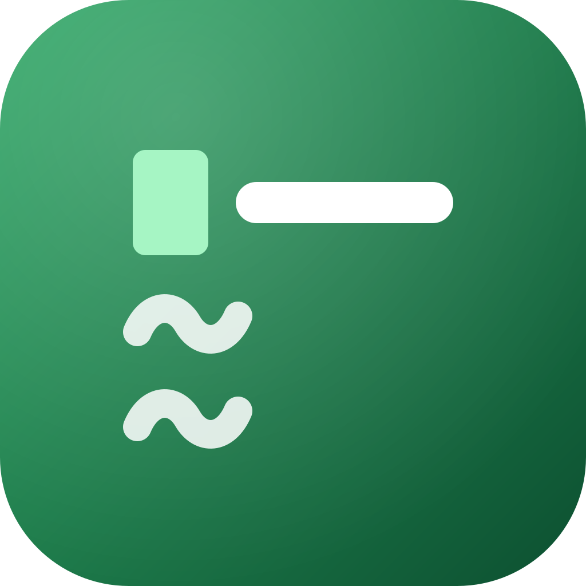

<!-- last_updated: 2026-11-25 -->
<!-- Authoring guidance: dev-docs/specs/README_SPEC.instructions.md -->
<!-- rumdl-disable MD033 MD041 -->

  

<h1 align="center">Plain Vim Practice</h1>

  A study aid for people learning the Vim text editor: read how everyday
  commands work, try them in a built-in emulator, and test yourself with
  quizzes and editing challenges.

<!-- rumdl-enable MD033 MD041 -->

---

## About

Vim's keys do different things in different modes, and the commands only
become second nature with practice. Plain Vim Practice gives you a pocket
reference of 67 everyday commands and six short guides, a small Vim-style
editor for trying commands on practice text, and quizzes, key-combo exercises
and editing challenges that check what you remember. It needs no account,
shows no ads, and works offline.

Get it on
[Google Play](https://play.google.com/store/apps/details?id=com.plaintxtoffice.plainvimpractice)
for Android phones and tablets. The iOS app is in App Store review.

## Features

- Browse 67 commands in nine categories, from moving around and deleting to
  text objects, search and replace, and saving and quitting, or search them by
  keys or task.
- Read each command's summary, syntax, and worked examples, most showing the
  text before and after the keys, with tips for many, and copy any example.
- Mark commands as learned.
- Take multiple-choice or type-the-command quizzes of 5 to 30 questions on
  every command, the ones you have not learned, the ones that need review, or
  a single category.
- Practice key combos: pick the keys that do an editing task, or build them
  from pieces, leaving out one decoy, in rounds of 1 to 20 questions.
- Read six short guides: modes, operators and motions, counts and repeating,
  text objects, search and replace, and saving and quitting.
- Try commands in the emulator, a small Vim-style editor with four practice
  texts and a row of keys the on-screen keyboard lacks, such as **Esc** and
  **Ctrl-R**. It also accepts a hardware keyboard.
- Solve 14 editing challenges that turn one text into another, with your key
  count compared against par and your best count kept. The first three
  challenges are in the base plan.
- Full Access (paid): an optional one-time purchase that opens all 14
  challenges. It is not a subscription and works offline. It is sold through
  the App Store on iOS (in App Store review) and through Google Play on
  Android.
- Send a bug report or feature request from inside the app.

Your progress stays on your device. The app has no analytics or tracking, and
its only network use is the store, for the price of Full Access and your
purchases.

## App Screenshot

<!-- Add at least one screenshot per implemented platform from platform/<platform>/assets/screenshots/, with descriptive alt text. -->
<!-- Label each image with its platform when more than one platform is shown. -->
<!-- Use centered, linked HTML images with explicit widths: start at 640 px for desktop or 280 px for portrait phones. Preserve proportions and link to the full-size image. -->
<!-- Follow the screenshot example in the README specification, including its scoped MD033 exception, and check the rendered layout at desktop and narrow widths. -->

## User Manual

See the [User Manual](docs/USER_MANUAL.md) for installation, setup, usage, and
troubleshooting.

## Feedback

Send bug reports and feature requests to
[feedback@plaintxtoffice.com](mailto:feedback@plaintxtoffice.com) or through
the [contact page](https://plaintxtoffice.com/contact/). In the app,
**Send Feedback** is on the **Home** tab and under **About** in the **Docs**
tab's **Guides**. It prepares an email to the same address in your email app,
or opens the contact page.

## License

Plain Vim Practice is proprietary software owned by Plain Text Office LLC; all
rights reserved.

Vim is free software by Bram Moolenaar and the Vim contributors. Plain Vim
Practice is an independent study aid and is not affiliated with or endorsed by
the Vim project. Its emulator was written for this app and contains no Vim
code.
